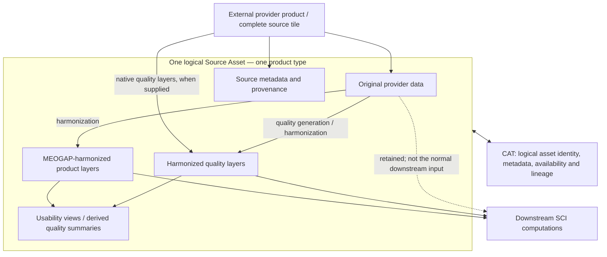
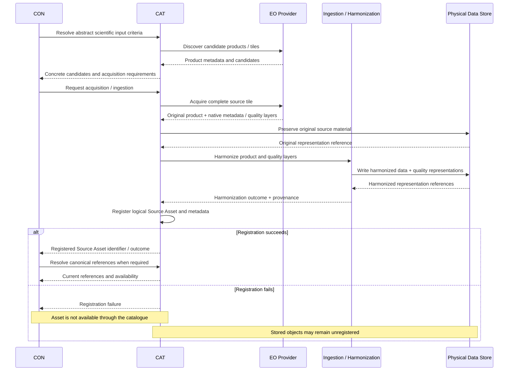
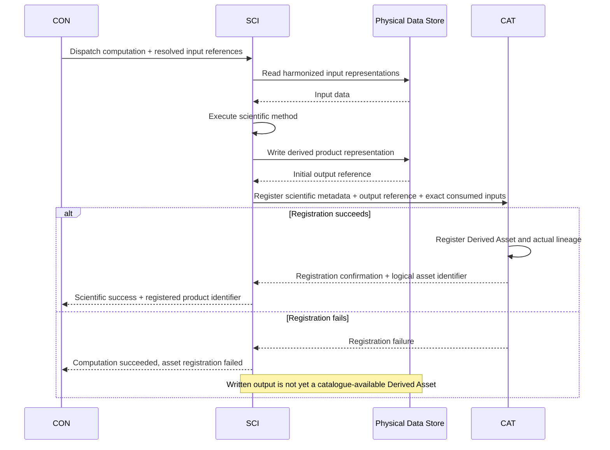

# Catalogue Responsibilities and Asset Lifecycle

**Status:** Working design note — user-reviewed conceptual decisions for M0-E02-T03 (#117)  
**Last updated:** 16 November 2026  
**Scope:** Terminology, logical asset composition, source/derived asset lifecycles, catalogue responsibilities and scientific metadata.  
**Not an implementation specification, API contract, ADR or storage-format decision.**

> This note records the current conceptual direction. It deliberately separates validated logical responsibilities from an envisaged internal data model. Zarr and H3 are discussed as architectural directions, not selected M0 technologies or contracts.

## 1. Purpose

MEOGAP needs two distinct catalogues:

- **Product Catalogue:** discoverable scientific product definitions and requestability metadata. SCI owns product definitions and their scientific meaning; definitions are repository artifacts.
- **Data/Asset Catalogue (CAT):** registration, discovery, availability, metadata and actual lineage for concrete source observations and derived data assets.

The Product Catalogue answers **“What scientific product can be requested, and what does its method require?”** CAT answers **“Which concrete data assets exist, what do they contain, where can they be accessed, and what observations or products do they derive from?”**

A product definition is not an asset. A request or execution plan is not an asset catalogue entry.

## 2. Terminology

| Term | Meaning |
|---|---|
| Product Definition | Versioned scientific specification of a product that can be computed or requested. Owned by SCI. |
| Product Instance | A concrete instance of a Product Definition, characterized by its definition/version, spatial and temporal support, parameters and scientific outcome. |
| Asset | A logical, catalogue-managed data entity representing one product type and one concrete source or derived instance. |
| Source Asset | An asset ingested from an external provider/source into MEOGAP. It is an L0 input in MEOGAP's internal conceptual levels, irrespective of the provider's processing level or scientific complexity. |
| Derived Asset | An asset produced by a MEOGAP scientific processing operation. It corresponds to a product instance at an internal level Ln, n > 0. |
| Representation | A logical/physical encoding or organization of an asset's data, such as original provider data or a MEOGAP-harmonized representation. |
| Physical object | A file, chunk, collection or other stored object that materializes some part of a representation. |
| Harmonization | Ingestion-time preparation that converts source data and associated quality information into MEOGAP-compatible representations. It does not automatically create a new Derived Asset. |

### 2.1 Source/derived classification is based on origin in MEOGAP

The same scientific product type may exist as either a Source Asset or a Derived Asset.

For example, a provider-precomputed NDVI ingested into MEOGAP is a **Source Asset**. An NDVI computed by MEOGAP from compatible inputs is a **Derived Asset**. This distinction supports provenance and scientific validation: instances of the same product type can be compared without conflating their production origins.

The internal L0–Ln terminology is independent of provider product levels (for example, Sentinel-2 L2A). A provider-processed product can still be L0 from MEOGAP's perspective when it is ingested as an external source.

## 3. Scientific input requirements are mission-independent

A Product Definition must express scientific input requirements in terms of abstract characteristics and compatibility criteria, not hard-coded satellite mission names.

For example, an NDVI definition may require compatible red and near-infrared measurements, with constraints on spectral response, spatial resolution, radiometric properties, temporal support and quality. Sentinel and Landsat observations may both satisfy the requirements, subject to the method's actual compatibility constraints.

SCI owns:
- the scientific input characteristics required by the method;
- compatibility rules and acceptable ranges;
- product-specific quality criteria and assumptions;
- selection constraints between multiple inputs when the method depends on their relative acquisition characteristics.

Examples of potentially useful selection constraints include:
- acquisition-time difference between observations, including local acquisition time where scientifically relevant;
- maximum or minimum number of days between acquisitions;
- minimum/maximum spatial resolution;
- required spectral bands or spectral-response characteristics;
- minimum/maximum spectral resolution;
- quality and usable-coverage thresholds over the requested footprint.

These are examples of criteria the model must be able to express, not a fixed M0 list. Their exact semantics and units belong to the scientific product definition. In particular, the meaning of "local acquisition time" (for example local solar time versus another local-time convention) must be explicit when a product uses it.

CAT owns:
- discovery of concrete acquisitions and assets;
- matching concrete metadata against SCI's requirements and selection constraints;
- returning the exact source/product instances that satisfy the criteria;
- computing objective footprint-specific quality statistics from retained quality layers, as described below.

A shared band label alone does not prove scientific interchangeability. Compatibility must be defined at the level needed by the method (for example spectral characteristics and resolution), and must not be assumed merely because two providers use similar names.

When CAT proposes an existing Derived Asset as an input, its suitability must not be established only from the derived asset's top-level metadata. The input constraints must be checked recursively against its actual lineage, including the source acquisitions and relevant intermediate product definitions/versions. The recursive check must establish that the underlying observations and transformations satisfy the requesting product's constraints. CON owns recursive dependency planning and orchestration; CAT resolves concrete assets and exposes actual lineage/metadata, but does not orchestrate generation of missing derived products.

## 4. Logical asset and physical composition

An Asset represents **one product type and one concrete instance**. It is a logical entity, not necessarily one file.

An Asset may be materialized by multiple physical objects or by a container holding multiple related data arrays. The logical asset identity must remain independent of storage technology and physical layout.

### 4.1 Source Asset composition — intended direction

For a source tile ingested by MEOGAP, the intended data organization is:

1. Preserve the provider's original product data.
2. Produce MEOGAP-harmonized representations for downstream processing.
3. Preserve source-provided quality layers and/or quality layers generated during ingestion.
4. Harmonize those quality layers into the same spatial representation as the data they qualify.
5. Keep enough metadata and provenance to trace every representation to its source, transformation and version.

A Zarr container is being considered as a convenient way to group the original product, harmonized data and quality layers. It is **not mandated by this note**.

Only MEOGAP-harmonized representations are intended to be consumed by subsequent MEOGAP scientific computations. The original provider data is retained for traceability, reprocessing and validation.

### 4.2 Whole source tile versus requested AOI

When a request intersects only a small part of a source tile, the intended acquisition strategy is to acquire and retain the complete source tile rather than clip away the rest of the source product.

Consequences:
- the Source Asset's spatial footprint is the footprint of the acquired tile/product;
- the user's AOI is a query/analysis subset, not a redefinition of the source asset footprint;
- quality statistics must be computable for a requested sub-area of the tile;
- a tile-level cloud percentage alone is insufficient to assess usability for a small AOI.

This is a design direction, not yet an acquisition policy or implementation requirement for M0.

### 4.3 Conceptual composition diagram

The diagram illustrates one logical Source Asset and its multiple internal data layers. It does not prescribe a storage schema.

The Source Asset is the catalogue entity. Original data, harmonized arrays, quality layers and usability views are constituent data/representations, not automatically separate assets.

## 5. Extensible quality-layer model

Quality information must not be reduced to one generic binary cloud mask or to one fixed list of optical-specific flags.

MEOGAP must be able to preserve and add independent quality layers according to the data modality and processing needs. Examples include:
- optical: cloud, cloud shadow, missing data and other provider or algorithm quality classes;
- SAR: modality-specific quality masks or indicators, to be identified when SAR support is designed;
- future modalities: additional quality layers without redesigning the logical Asset model.

The examples are illustrative, not a closed enumeration or an M0 implementation requirement.

### 5.1 Preserve independent layers

Quality layers should remain independently identifiable. A location may satisfy multiple quality conditions simultaneously. Do not collapse all conditions into one mutually exclusive classification or one usable/unusable flag at ingestion time.

At minimum, the conceptual model must allow:
- source-provided quality layers;
- MEOGAP-generated quality layers;
- distinct missing-data information;
- provenance and version information for each layer;
- derived usability interpretations that can change independently of the underlying masks.

### 5.2 Usability as an interpretation, not raw truth

A common spatial representation (H3 is the current candidate) should make it possible to determine which spatial units contain usable or unusable data, while retaining the quality evidence used to reach that conclusion.

The usable/unusable result is a derived interpretation based on explicit assumptions. Those assumptions may be destructive when aggregating or rescaling quality information to a coarser spatial support. They must therefore be:
- explicit and parameterized;
- versioned;
- attributable to a method/rule and its inputs;
- reproducible for a given version and parameter set;
- replaceable as project assumptions evolve;
- prevented from overwriting original data or detailed quality layers.

The model must distinguish the detailed quality evidence from the current usability policy/view. A change in the policy must not require changing the source observations.

### 5.3 Spatial and temporal support

The native resolution and support of the source data must remain known. An H3 representation is a harmonized/derived spatial representation, not a claim that the original sensor measured at H3 resolution.

Quality statistics must be computable by CAT for any requested footprint contained within a tile, using the retained quality layers. This includes cloud cover and, more generally, the percentage of usable data. The latter is derived from the inverse of the combined non-quality conditions (for example cloud, cloud shadow and missing data), under an explicitly identified quality policy. A tile-level percentage and a percentage over a requested AOI are different values and must not be conflated.

The calculation must identify its spatial support, denominator/weighting convention, quality layers and policy version. Missing or unknown quality information must not silently be treated as usable. The detailed masks remain available so that a later policy can recompute the statistic.

For multi-date products, the acquisition dates of the actual contributing observations must remain traceable; a single aggregate period does not replace the dates of the inputs.

## 6. Scientific metadata and CAT ownership

CAT must retain and index meaningful scientific metadata to support asset discovery, selection, research and later validation. CAT storing/indexing metadata does not make CAT the owner of scientific interpretation.

| Metadata category | Examples | Responsibility |
|---|---|---|
| Product identity | Product type, Source/Derived origin, internal level, definition reference where applicable | CAT classifies/registers; SCI owns scientific definitions |
| Spatial support | Footprint, native resolution, harmonized spatial support | CAT stores/indexes; SCI defines method requirements |
| Temporal support | Acquisition date/time, start/end, individual contributing acquisition dates | CAT stores/indexes |
| Observation quality | Provider cloud percentage, quality layers, missing-data information | CAT stores/indexes source and generated metadata; SCI defines product-specific acceptability |
| AOI-specific quality | Cloud coverage and percentage of usable data over a requested footprint contained in a tile | CAT computes from retained quality layers using an identified/versioned policy; CAT may index/cache results, but does not define product-specific scientific acceptance |
| Scientific result | Method, parameters, units, uncertainty, limitations and validation status | SCI produces and interprets; CAT retains/indexes relevant metadata |
| Physical access | Canonical asset reference, representation and current physical location | CAT |
| Actual lineage | Exact input asset/product instances and versions actually consumed | CAT records from SCI's registration handoff |

Provider-native metadata must be preserved as provider metadata. Statistics computed by MEOGAP (for example cloud coverage over a requested AOI) must be distinguishable from provider-supplied scene-level statistics.

SCI defines the scientific criteria for accepting observations for a given product. CAT computes objective footprint-specific statistics from retained layers, including the percentage of usable data (the inverse of the combined non-quality conditions under a declared policy). CAT may index/cache these statistics, but it must not decide that a given usable percentage is scientifically acceptable for every product.

### 6.1 SCI → CAT registration handoff

For a generated product, SCI supplies scientific result metadata, the initial physical-object reference and exact input references actually consumed. CAT registers the asset, its canonical reference/access metadata and actual lineage, then confirms registration.

CAT may index scientific metadata for search and discovery. It does not alter the scientific method or reinterpret the scientific outcome.

### 6.2 Independent status dimensions

Registration, physical availability and scientific quality are independent:

| Dimension | Illustrative states | Meaning |
|---|---|---|
| Registration | registered / not registered | Whether CAT has a catalogue record for the asset |
| Availability | available / unavailable / unknown | Whether the data can currently be retrieved |
| Scientific quality | valid / degraded / invalid / unknown | Scientific characterization for a defined use or validation context |

These labels are conceptual; exact enums and contracts are deferred. A registered asset must not disappear from CAT merely because its physical data is temporarily inaccessible. A successful registration does not imply scientific validity, and scientific validity does not imply physical availability.

## 7. Source Asset lifecycle

The nominal source lifecycle is:

1. **Identify / discover:** CON supplies abstract scientific input criteria; CAT discovers matching concrete source products/acquisitions.
2. **Select / resolve:** CAT identifies the concrete source tile/product and relevant provider metadata. CON owns the planned dependency and acquisition orchestration.
3. **Acquire:** CAT coordinates provider-specific acquisition. The intended strategy is to retain the complete source tile even when the request AOI is smaller.
4. **Preserve original:** the original provider product and native metadata/quality layers are retained.
5. **Harmonize:** MEOGAP creates internal representations of product data and quality layers, including the common spatial representation under consideration.
6. **Register:** CAT registers the logical Source Asset, its product type, footprint, temporal support, scientific/discovery metadata, representation references and provenance.
7. **Confirm availability:** CAT reports the registered logical asset and its availability outcome to CON. CON obtains canonical references/current locations from CAT when needed.
8. **Retrieve / consume:** downstream SCI computations consume the MEOGAP-harmonized representations, not the original provider representation as their normal input.
9. **Failure handling:** acquisition, harmonization, storage and registration failures must remain distinguishable. If registration fails, the data must not be treated as a catalogue-available input. Orphaned physical objects and retry/cleanup behavior remain execution-design topics.

This is a conceptual lifecycle, not a final orchestration/API contract. The logical responsibilities already established remain: CON orchestrates missing L0 ingestion; CAT owns the functional acquisition/ingestion and catalogue registration responsibility; execution workers are mechanisms, not peer logical components.

## 8. Derived Asset lifecycle and composition

A Derived Asset is created by a MEOGAP scientific computation and corresponds to a Product Instance. It remains one logical asset for one product type, even if its physical representation comprises multiple objects.

Nominal lifecycle:

1. CON dispatches a computation after resolving its dependencies.
2. SCI retrieves the canonical input references provided through the established CON/CAT boundary and performs the scientific method.
3. SCI writes the generated product representation.
4. SCI supplies CAT with the Product Definition/version, parameters, spatial and temporal support, scientific result metadata, quality/limitations, initial object reference and exact input asset/product references actually consumed.
5. CAT registers the Derived Asset and its actual lineage.
6. CAT confirms registration to SCI; only then can CON treat the product as available for dependent work.
7. A computation failure and a registration failure remain distinct outcomes.

The physical format of a Derived Asset is not specified here. A common container/representation strategy may be designed later, but must preserve product identity, data characteristics, method/version, parameters, quality and provenance.

## 9. Responsibilities

| Concern | SCI | CAT | CON | GAT |
|---|---|---|---|---|
| Product definitions and scientific methods | Owns | No | No | Exposes catalogue view |
| Abstract scientific input criteria | Defines | Resolves to concrete assets | Orchestrates recursive resolution | No |
| Concrete source discovery and acquisition | No | Owns functional responsibility | Orchestrates request | No direct CAT interface |
| Source Asset registration and physical references | Supplies no scientific definition of source | Owns | Consumes outcome | No direct CAT interface |
| Harmonization method and scientific interpretation | Owns scientific semantics where relevant | Retains/indexes outcome and references | Orchestrates workflow | No |
| Derived scientific computation | Owns | No | Dispatches/orchestrates | No |
| Derived Asset registration and actual lineage | Supplies metadata and actual consumed inputs | Owns | Consumes registration outcome | No direct CAT interface |
| Planned execution graph | No | No | Owns | No |
| Scientific quality/acceptance criteria | Defines | Stores/indexes relevant metadata | Uses outcomes in orchestration | Presents information |
| Canonical asset reference and current physical location | No | Owns | Queries CAT when needed; no duplicate catalogue | No direct CAT interface |
| User access/request lifecycle | No | No | Owns access decisions and request lifecycle | Public REST boundary |

GAT has no direct CAT interface in the validated logical model. User-facing asset and lineage operations pass through CON for authorization and orchestration.

## 10. M0 versus deferred capabilities

### 10.1 Conceptual responsibilities relevant to M0

M0 should exercise only the minimum CAT behavior needed by the reference journey:
- distinguish Product Catalogue definitions from registered data assets;
- register and discover source and derived assets;
- preserve enough metadata to identify product type, spatial/temporal support and provenance;
- expose registration/availability outcomes distinctly from scientific computation outcomes;
- provide canonical logical asset references and current access references to CON;
- record actual lineage for generated products;
- support the SCI → CAT registration and CAT → CON discovery/availability boundaries.

The exact M0 mock behavior and contract fields belong to the relevant contract/implementation tickets, not this note.

### 10.2 Explicitly deferred

The following are not required to be decided or implemented by #117:
- a dedicated CAT microservice/package or deployment boundary;
- a specific database, object store or file layout;
- Zarr schema, group/array naming, chunking, codecs or migration mechanism;
- H3 resolution, indexing strategy or resampling/rescaling algorithms;
- complete multi-modal quality-mask taxonomy (including future SAR-specific layers);
- quality-policy language and product-specific thresholds;
- caching/precomputation strategy for AOI-specific quality statistics;
- large-scale search/index optimization and enterprise catalogue capabilities;
- full reprocessing, retention, garbage collection and orphan-object reconciliation policy.

## 11. Design constraints and open questions for later work

The following constraints should be preserved when the detailed data model is designed:

1. Logical Asset identity must not depend on a particular storage technology or serialization.
2. A single Asset represents one product type; a physical container may contain multiple arrays/layers that materialize that product.
3. Original source data must remain distinguishable from harmonized MEOGAP representations.
4. Downstream scientific computations use harmonized representations under the intended processing model.
5. Native spatial resolution and support must remain explicit; H3 must not imply false native precision.
6. Quality layers remain independent, extensible and traceable. A current usability view is a derived interpretation, not a replacement.
7. Any destructive aggregation/rescaling assumption must be explicit, versioned and reproducible.
8. Source-tile footprint and request AOI are distinct. AOI-specific quality statistics must be computed for the AOI, not inferred from a tile-wide percentage.
9. Multi-date products must preserve the exact acquisition dates and asset references actually used.
10. Planned execution dependencies in CON are distinct from actual input lineage registered by CAT.
11. Product input criteria may express temporal relationships between acquisitions, spatial/spectral resolution bounds, band compatibility and quality constraints.
12. Reusing a Derived Asset requires recursive validation of its actual lineage against the requesting product's input constraints; top-level derived metadata alone is insufficient.
13. CAT can calculate usable-data percentages for a requested footprint contained in a source tile from retained quality layers, with the policy and spatial support identified.

Questions for later design include:
- How should an Asset expose multiple representations and their versions without coupling its identity to a Zarr-specific layout?
- Which parts of harmonization are mandatory for every source modality, and which are modality-specific?
- What is the precise semantics of an H3 usability summary at different resolutions?
- How should masks represent multiple simultaneous conditions, uncertainty/probability and unknown/missing classification?
- Which objective quality statistics should CAT compute on demand, cache or index, and what exact denominator/area-weighting convention should be used?
- How are acquisition-time relationships (including local acquisition time) represented consistently across missions and time conventions?
- How are recursive lineage checks performed efficiently when multiple derived assets share common ancestors?
- How are harmonization failures, partial tile acquisitions and unregistered physical objects reconciled?
- What is the minimum provenance needed to reproduce an individual harmonized array and a derived scientific result?

These are future design questions. They do not block the conceptual responsibility and lifecycle note.

## 12. Decision boundary

This note records **logical and scientific design direction**, not a binding storage architecture.

In particular:
- Zarr is an envisaged container, not a selected M0 format.
- H3 is a candidate common spatial representation, not a settled resolution or contract.
- Full-tile acquisition is the intended source-data strategy, not yet an implemented behavior.
- Extensible modality-specific quality layers are a model requirement; specific SAR masks and algorithms remain future work.
- Harmonization is conceptually distinct from scientific product generation, but its exact component/execution ownership and detailed contracts must be aligned with the later ingestion design.

No ADR is created by this note: no storage, deployment or implementation technology is selected.
