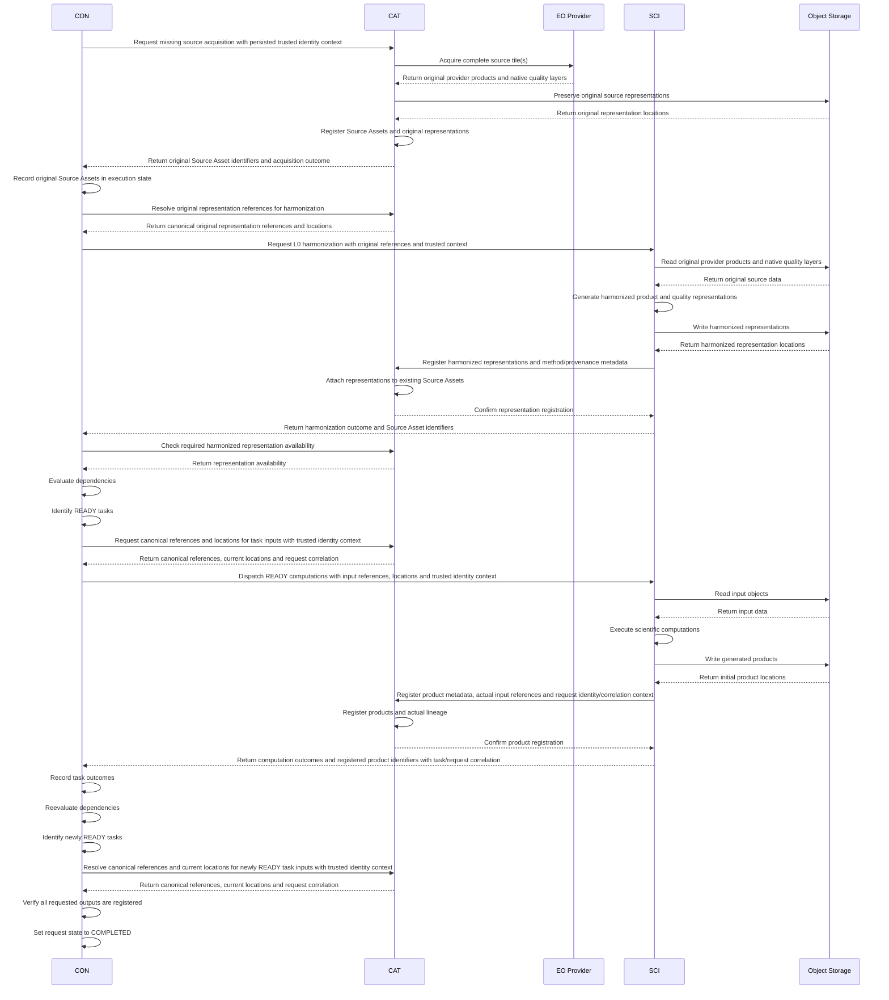

# Execute Analysis

**Status:** Validated sequence diagram — design baseline  
**Companion documents:** [Component Interaction Design](../system-interactions/component-interaction-design.md) · [Component Interaction Matrix](../system-interactions/component-interaction-matrix.md) · [Submit Analysis Request](./submit-analysis-request.md)  
**Last updated:** 16 November 2026

## Purpose

Describe the nominal execution of a confirmed analysis request, from the acquisition/ingestion of missing L0 source data through dependency-aware scheduling, scientific computation, asset registration and final request completion.

The request is assumed to be in IN_EXECUTION state, with an accepted execution plan and its trusted identity/correlation context already persisted by CON. Deferred workers restore this context when executing a task; they do not depend on the original HTTP request or external credential remaining available.

## Sequence

## Validated execution rules

1. **Original L0 acquisition precedes harmonization and dependent calculations.** CON asks CAT to acquire missing source tiles. CAT acquires and preserves the original provider products and native quality layers, then registers the Source Assets and original representations. This registration does not imply that MEOGAP-harmonized representations are ready.
2. **SCI owns L0 harmonization; CON orchestrates it.** After original Source Asset registration, CON obtains the original representation references from CAT and requests harmonization from SCI. SCI generates harmonized product and quality representations and submits their references/provenance to CAT. CAT registers those representations against the existing Source Asset. CON checks that the representations required by downstream tasks are available before dispatching them.
3. **CON owns dependency-aware scheduling.** CON evaluates the persisted execution plan and dispatches only tasks whose required input representations/assets are available.
4. **Workers do not resolve scientific dependencies.** Workers are execution mechanisms, not logical components. CON dispatches eligible tasks to SCI for execution by workers; workers do not independently traverse the dependency plan or repeatedly requeue tasks whose dependencies are not ready.
5. **Independent READY tasks may execute concurrently.** CON dispatches all tasks currently eligible for execution without waiting for each task to finish before dispatching the next. Completion outcomes are received later; the diagram does not prescribe the internal transport.
6. **A generated intermediate product becomes available to dependent tasks only after CAT registration succeeds.** SCI writes the object to storage, sends CAT the computation metadata, initial location and exact input references actually consumed. CAT registers the product and actual lineage, may reorganize the stored object, and confirms registration to SCI. SCI reports the computation outcome to CON. CON does not maintain a duplicate product-to-asset or asset-to-location mapping.
7. **CON reevaluates dependencies after outcomes.** When a task succeeds, CON reevaluates the execution plan. For newly READY tasks, CON asks CAT for the canonical references and current locations of their input assets before dispatching the computations. CON records task outcomes and logical identifiers, not CAT's asset-to-location mapping.
8. **A task is considered SUCCEEDED only after successful asset registration.** Scientific computation success alone is insufficient to make the product available to downstream tasks.
9. **Request completion is verified.** CON moves the request to COMPLETED only when every requested output product has been successfully generated and registered in CAT, or otherwise satisfied by an already available asset. No required task may remain blocked, pending or running. CAT remains the source of truth for the resulting asset references and locations.
9. **Identity survives asynchronous execution.** CON persists the trusted caller context with the request/task; workers restore it when running ingestion or computation. SCI and CAT use the propagated context for operation attribution, audit and tracing, not to replace CON's authorization decisions. The external credential itself is not stored in task context or logs.

## Conceptual task states

The following state names illustrate the dependency scheduler's logical distinctions. Their exact vocabulary and persistence model remain to be defined in interface/contract design.

| State | Meaning |
|---|---|
| BLOCKED | One or more dependencies are not yet available. |
| READY | All required input references are available; the task can be dispatched. |
| RUNNING | The computation has been dispatched and is in progress. |
| SUCCEEDED | Computation and CAT asset registration succeeded; the product is available in CAT. |
| FAILED | Computation or asset registration failed. |
| CANCELLED | The task will not be executed because the request was cancelled. |

The request can remain IN_EXECUTION while some tasks are BLOCKED and others are RUNNING. Task state and request state are separate concepts.

## Notes and boundaries

- The sequence covers the nominal path. Acquisition failure, computation failure, asset-registration failure, cancellation during execution and recovery are handled in the dedicated failure/recovery sequence.
- The diagram shows one scheduling pass. CON repeats dependency evaluation, dispatch and outcome processing until the execution plan is complete. If no task is READY while work remains outstanding, CON waits for an ingestion/computation outcome and reevaluates the plan; it does not repeatedly requeue blocked tasks.
- The exact granularity of CAT's original-acquisition outcome is still open: CAT may report each acquisition independently or return a consolidated outcome. The outcome must identify the Source Assets whose original representations were registered.
- Harmonization is a distinct SCI operation after original registration. Its outcome must identify the Source Assets processed; CON must check CAT for the availability of each required harmonized representation before scheduling dependent tasks.
- The detailed harmonization failure/recovery policy, retry behavior and partial success granularity remain open.
- The sequence does not prescribe whether internal dispatch and completion use NATS, REST or another transport. It does not model workers as logical components.
- The precise concurrency limit, retry/backoff policy, duplicate-task prevention, idempotency and scheduler recovery behavior belong to interface/execution contract design.
- Object storage is infrastructure. SCI accesses input objects and writes output objects directly; CAT owns catalogue registration, actual lineage, canonical asset references and current storage locations. CON requests those references and locations from CAT when it needs to dispatch a dependent computation or deliver a result; it does not maintain a duplicate catalogue or storage mapping.
