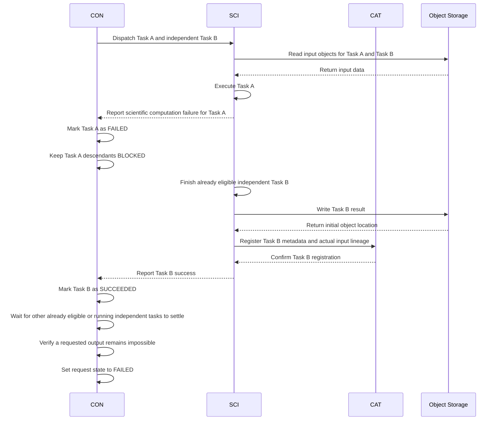
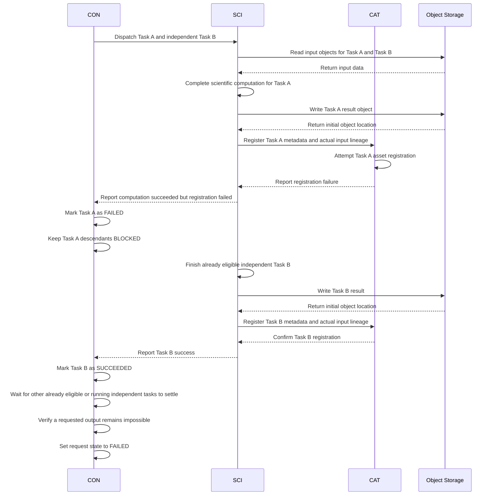

# Failure and Recovery

**Status:** Validated failure-handling policy — design baseline  
**Companion documents:** [Component Interaction Design](../system-interactions/component-interaction-design.md) · [Component Interaction Matrix](../system-interactions/component-interaction-matrix.md) · [Execute Analysis](./execute-analysis.md)  
**Last updated:** 12 November 2026

## Purpose

Describe two distinct failure cases during scientific product execution:

1. Scientific computation fails before a generated product is registered.
2. Scientific computation succeeds, but CAT fails to register the generated product.

The distinction matters because a file may exist in object storage even though no usable catalogue asset exists. Both scenarios run under the trusted identity/correlation context persisted with the originating request; workers restore it, and SCI/CAT outcomes retain the request and processing-run correlation without carrying the external credential.

## 1. Scientific computation failure

In this case SCI cannot generate the requested product. No registration request is sent to CAT for the failed task.

The example includes a second task that was already eligible and independent of the failed task. CON allows that already eligible work to finish, but does not dispatch descendants of the failed task.

## 2. Asset-registration failure

In this case SCI completes the scientific computation and writes the generated object to storage, but CAT cannot register the product and its actual lineage.

The generated file may therefore exist in storage without being a usable catalogue asset. Dependent tasks must not consume it.

The example again includes an independent task that was already eligible and is allowed to finish.

## Validated failure-handling rules

1. **Scientific failure and registration failure are distinct outcomes.** SCI reports which stage failed to CON.
2. **A task is SUCCEEDED only after CAT confirms successful asset registration.** Successful computation alone is not sufficient.
3. **A failed task's descendants remain BLOCKED.** CON must not dispatch a task whose required dependency failed or whose output is not registered in CAT.
4. **Already eligible independent work may finish.** CON allows independent tasks that were already READY or RUNNING when the failure was detected to complete. This avoids discarding useful work that does not depend on the failed task.
5. **The failure prevents false completion.** If a requested final product cannot be generated because a required task failed, the request cannot become COMPLETED.
6. **The request becomes FAILED after already eligible/running independent work has settled**, once CON determines that a requested output remains impossible to produce.
7. **CAT remains the source of truth.** A generated file that was not registered successfully is not an available product and cannot satisfy dependencies.
8. **Identity context is retained through failure handling.** The request and affected tasks keep their original trusted owner and correlation context. SCI/CAT use it for audit/trace attribution; CON remains responsible for user-facing access decisions.

## Task and request state interpretation

The existing conceptual task states remain:

| Task state | Meaning in these scenarios |
|---|---|
| `FAILED` | The scientific computation failed, or the computation succeeded but CAT registration failed. The failure reason must remain distinguishable. |
| `BLOCKED` | A required dependency is not available. A descendant of a failed task remains blocked. |
| `SUCCEEDED` | Computation completed and CAT registration succeeded. |

The request remains `IN_EXECUTION` while already eligible independent tasks are still running. It transitions to `FAILED` when those tasks have settled and at least one requested output remains impossible to produce.

## Recovery topics deliberately left open

This design does not decide:
- Automatic retry policy, retry limits or backoff.
- Which failure categories are transient or permanent.
- Idempotency rules for repeated SCI computation or CAT registration requests.
- Cleanup, retention or quarantine of an object written to storage but not registered in CAT.
- Whether a failed request can be resumed, replanned or must be submitted again.
- Cost treatment for partially completed requests.
- Cancellation races with in-flight acquisition or computation.

These topics belong in interface/execution contract design and, where they require structural choices, a separate ADR.

## Scope boundary

The diagrams show the two failure types required by the component-interaction design. They do not define worker topology, NATS subjects, REST routes, payload schemas or concrete recovery algorithms. Workers remain execution mechanisms; they are not logical components.
