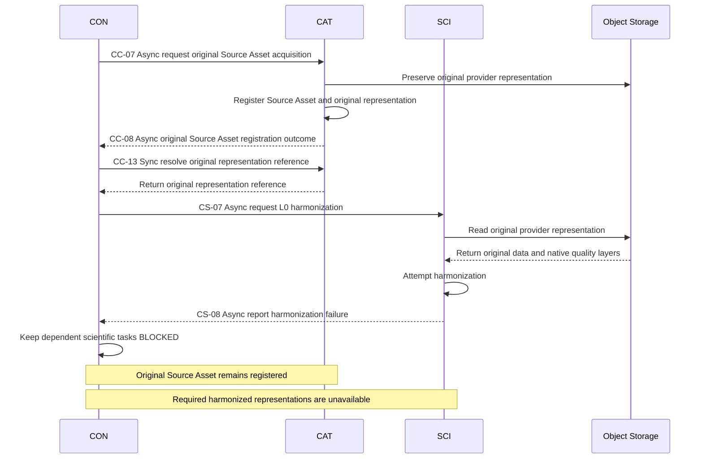
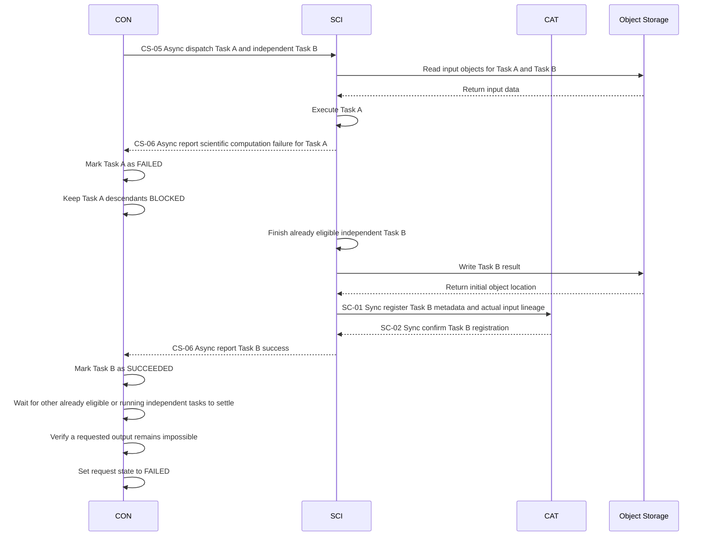
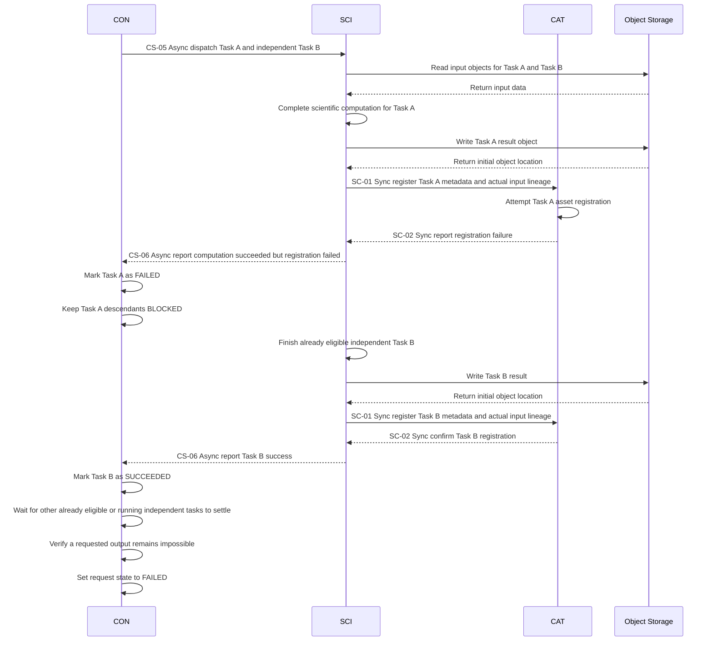
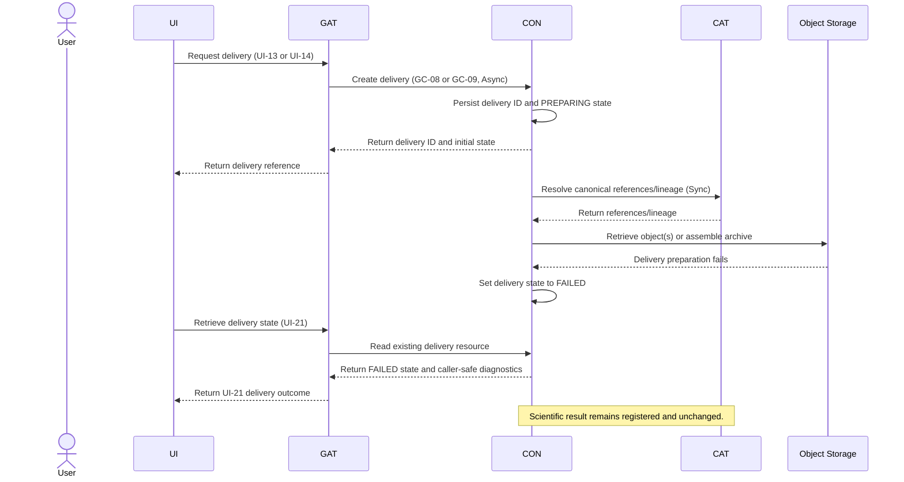

# Failure and Recovery

**Status:** Validated failure-handling policy — design baseline  
**Companion documents:** [Component Interaction Design](../system-interactions/component-interaction-design.md) · [Component Interaction Matrix](../system-interactions/component-interaction-matrix.md) · [Execute Analysis](./execute-analysis.md)  
**Last updated:** 20 November 2026

## Purpose

Describe four distinct failure cases across source preparation, scientific product execution and delivery:

1. L0 harmonization fails after the original Source Asset has been acquired and registered.
2. Scientific computation fails before a generated Derived Asset is registered.
3. Scientific computation succeeds, but CAT fails to register the generated Derived Asset.

The distinction matters because a file may exist in object storage even though no usable catalogue asset exists. Both scenarios run under the trusted identity/correlation context persisted with the originating request; workers restore it, and SCI/CAT outcomes retain the request and processing-run correlation without carrying the external credential.

## 1. L0 harmonization failure

In this case CAT has successfully acquired, preserved and registered the original provider representation of a Source Asset, but SCI cannot generate the required MEOGAP-harmonized product and quality representations.

The original Source Asset remains registered and its original representation may remain available. The required harmonized representations are unavailable, so dependent scientific computations must remain BLOCKED. This is not a Derived Asset computation failure and must not remove or invalidate the original Source Asset.

## 2. Scientific computation failure

In this case SCI cannot generate the requested Derived Asset. No registration request is sent to CAT for the failed task.

The example includes a second task that was already eligible and independent of the failed task. CON allows that already eligible work to finish, but does not dispatch descendants of the failed task.

## 3. Derived Asset registration failure

In this case SCI completes the derived-product computation and writes the generated object to storage, but CAT cannot register the Derived Asset and its actual lineage.

The generated file may therefore exist in storage without being a usable catalogue asset. Dependent tasks must not consume it.

The example again includes an independent task that was already eligible and is allowed to finish.

## 4. Asynchronous delivery failure

Delivery preparation is a separate asynchronous lifecycle owned by CON. A failure while retrieving a final product object or assembling a dependency archive updates the delivery resource to `FAILED` and is exposed through UI-21. It does not change the scientific request/result state and does not invalidate a result that remains successfully registered in CAT.

A retry is represented as a new delivery request through GC-08 (final product) or GC-09 (dependency archive), unless a later delivery contract explicitly defines idempotent retry of the same delivery resource. Retry policy, temporary-object cleanup and retention of failure diagnostics remain open.

## Validated failure-handling rules

1. **L0 harmonization failure is distinct from Derived Asset computation or registration failure.** SCI reports harmonization failure to CON; the original Source Asset remains registered, but dependent tasks remain BLOCKED until their required harmonized representations are available.
2. **Scientific failure and Derived Asset registration failure are distinct outcomes.** SCI reports which stage failed to CON.
3. **A task is SUCCEEDED only after CAT confirms successful Derived Asset registration.** Successful computation alone is not sufficient.
4. **A failed task's descendants remain BLOCKED.** CON must not dispatch a task whose required dependency failed or whose required representation is not registered/available in CAT.
5. **Already eligible independent work may finish.** CON allows independent tasks that were already READY or RUNNING when the failure was detected to complete. This avoids discarding useful work that does not depend on the failed task.
6. **The failure prevents false completion.** If a requested final product cannot be generated because a required task failed, the request cannot become COMPLETED.
7. **The request becomes FAILED after already eligible/running independent work has settled**, once CON determines that a requested output remains impossible to produce.
8. **CAT remains the source of truth.** A generated file that was not registered successfully is not an available product and cannot satisfy dependencies.
9. **Identity context is retained through failure handling.** The request and affected tasks keep their original trusted owner and correlation context. SCI/CAT use it for audit/trace attribution; CON remains responsible for user-facing access decisions.

## Task and request state interpretation

The existing conceptual task states remain:

| Task state | Meaning in these scenarios |
|---|---|
| `FAILED` | A Derived Asset computation failed, or the computation succeeded but CAT registration failed. The failure reason must remain distinguishable. L0 harmonization failure is tracked as a source-preparation outcome, not as a Derived Asset task failure. |
| `BLOCKED` | A required dependency is not available. A descendant of a failed task remains blocked. |
| `SUCCEEDED` | Computation completed and CAT registration succeeded. |

The request remains `IN_EXECUTION` while already eligible independent tasks are still running. It transitions to `FAILED` when those tasks have settled and at least one requested output remains impossible to produce.

## Recovery topics deliberately left open

This design does not decide:
- Automatic retry policy, retry limits or backoff.
- Which failure categories are transient or permanent.
- Idempotency rules for repeated SCI computation or CAT registration requests.
- Cleanup, retention or quarantine of an object written to storage but not registered in CAT.
- Whether a failed request can be resumed, replanned or must be submitted again.
- Cost treatment for partially completed requests.
- Cancellation races with in-flight acquisition or computation.

These topics belong in interface/execution contract design and, where they require structural choices, a separate ADR.

## Scope boundary

The diagrams show L0 harmonization failure, the two Derived Asset failure types and the separate asynchronous delivery-failure lifecycle. They do not define worker topology, NATS subjects, REST routes, payload schemas or concrete recovery algorithms. Workers remain execution mechanisms; they are not logical components.
