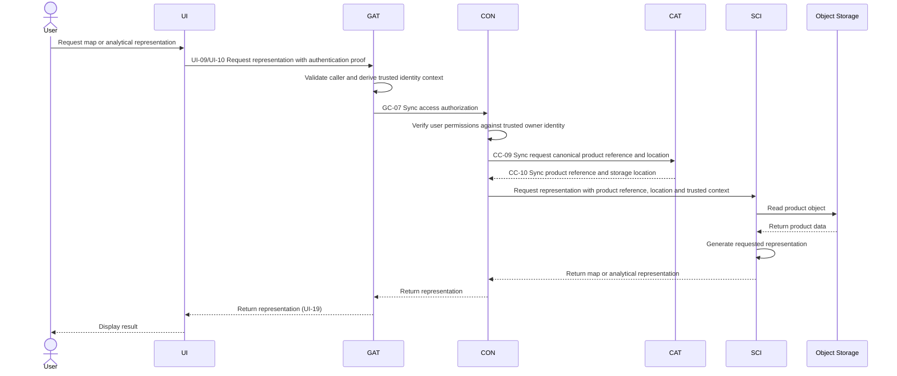
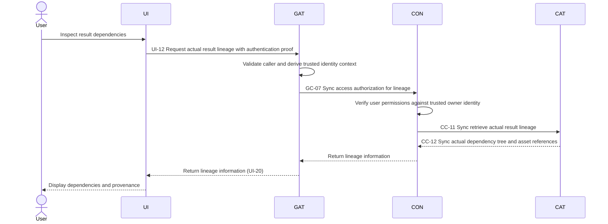

# Retrieve and Display a Result

**Status:** Validated sequence diagrams — updated synchronization decisions  
**Companion documents:** [Component Interaction Design](../system-interactions/component-interaction-design.md) · [Component Interaction Matrix](../system-interactions/component-interaction-matrix.md) · [Interface Contract Inventory](../system-interactions/interface-contract-inventory.md) · [Submit Analysis Request](./submit-analysis-request.md) · [Execute Analysis](./execute-analysis.md)  
**Last updated:** 20 November 2026

## Purpose

Describe the result-retrieval paths after a product has been generated and registered in CAT:

1. Generate and display a map or analytical representation.
2. Inspect the actual lineage of a result.
3. Request asynchronous delivery of the final product alone.
4. Request asynchronous generation of an archive containing the result and its actual dependencies.

Visualization and lineage retrieval are synchronous interactions. Both delivery types are asynchronous from the start and return a persistent delivery identifier.

## 1. Visualize a result

The request is routed through CON for authorization. CON asks CAT for the canonical product reference and current storage location, then passes the information to SCI. CON does not keep a duplicate mapping. SCI reads the stored product and generates the requested representation. This operation is classified as synchronous in the current interaction inventory.



## 2. Inspect actual result lineage

The displayed lineage is the actual provenance recorded by CAT for the selected result. It is not the planned execution graph held by CON. This is a synchronous read.



Physical storage locations are not part of the user-facing lineage representation unless a separate authorized use case explicitly requires them.

## 3. Asynchronous delivery of the final product only

This operation delivers only the requested product. It does not package dependencies. UI-13 starts an asynchronous delivery through GC-08. The first response contains a persistent delivery identifier and initial state. Object retrieval takes place outside the public request/response cycle. UI-21 exposes the later state and secure access through the same delivery resource.

```mermaid
sequenceDiagram
    actor User
    participant UI
    participant GAT
    participant CON
    participant CAT
    participant S3 as Object Storage

    User->>UI: Download final product
    UI->>GAT: UI-13 Request final-product delivery with authentication proof
    GAT->>GAT: Validate caller and derive trusted identity context
    GAT->>CON: GC-08 Async create final-product delivery
    CON->>CON: Verify user permissions and persist delivery resource
    CON-->>GAT: Return delivery ID and initial state (PREPARING)
    GAT-->>UI: Return delivery ID and initial state

    CON->>CAT: CC-09 Sync request canonical product reference and location
    CAT-->>CON: CC-10 Sync canonical reference and current location
    CON->>S3: Retrieve final product object asynchronously
    S3-->>CON: Return product object
    CON->>CON: Store/prepare secure delivery and set delivery state READY
    Note over CON,GAT: UI-21 is the asynchronous delivery-state/access outcome on this delivery resource.
    UI->>GAT: Retrieve delivery resource by delivery ID (UI-21)
    GAT->>CON: Read current delivery state/access from the GC-08 resource
    CON-->>GAT: Return PREPARING, READY or FAILED state; secure access only when READY
    GAT-->>UI: Return delivery state/access (UI-21)
    UI-->>User: Download final product when READY
```

The delivery workflow is asynchronous even though a REST read of the existing delivery resource is a synchronous retrieval. The logical inventory contains no separate GC-10/GC-11 status interface or GC-12/GC-13 access interface. The same delivery identifier returned by GC-08 is used to retrieve its current state and eventual access information.

## 4. Asynchronous generation of the dependency archive

The archive is generated on demand from CAT's actual lineage and the corresponding canonical asset references/current locations. GC-09 starts an asynchronous delivery resource. CON owns delivery orchestration and ZIP assembly; it does not maintain a duplicate asset catalogue or storage mapping.

```mermaid
sequenceDiagram
    actor User
    participant UI
    participant GAT
    participant CON
    participant CAT
    participant S3 as Object Storage

    User->>UI: Request complete dependency archive
    UI->>GAT: UI-14 Request dependency archive with authentication proof
    GAT->>GAT: Validate caller and derive trusted identity context
    GAT->>CON: GC-09 Async create dependency-archive delivery
    CON->>CON: Verify user permissions and persist delivery resource
    CON-->>GAT: Return delivery ID and initial state (PREPARING)
    GAT-->>UI: Return delivery ID and initial state

    CON->>CAT: CC-11 Sync retrieve actual result lineage
    CAT-->>CON: CC-12 Sync actual dependency tree
    CON->>CAT: CC-09 Sync request canonical references/locations for lineage assets
    CAT-->>CON: CC-10 Sync canonical references/current locations
    CON->>S3: Retrieve result and dependency objects asynchronously
    S3-->>CON: Return requested objects
    CON->>CON: Assemble temporary ZIP archive
    CON->>S3: Store temporary archive
    S3-->>CON: Return temporary archive location
    CON->>CON: Set delivery state READY (or FAILED on delivery error)

    UI->>GAT: Retrieve delivery resource by delivery ID (UI-21)
    GAT->>CON: Read current delivery state/access from the GC-09 resource
    CON-->>GAT: Return PREPARING, READY or FAILED state; secure access only when READY
    GAT-->>UI: Return delivery state/access (UI-21)
    UI-->>User: Download archive when READY
```

The delivery workflow is asynchronous. UI-21 exposes the later state and secure access through the delivery resource created by GC-09. GC-10 through GC-13 are not separate logical interactions.

## Validated responsibility and synchronization rules

1. **CON does not maintain a duplicate product/asset catalogue.** CAT remains the single source of truth for canonical asset references, storage locations and actual lineage.
2. For visualization, CON authorizes the caller, obtains the canonical product reference/location from CAT and asks SCI for the representation. UI-09/UI-10 and UI-19 are synchronous in the current interaction inventory.
3. For lineage inspection, CON asks CAT for actual lineage and returns it through GAT. UI-12/UI-20 are synchronous; the planned execution graph is not substituted for actual lineage.
4. **GC-08/UI-13 and GC-09/UI-14 are asynchronous.** Each returns a delivery identifier and initial state. Long-running object retrieval/archive preparation occurs outside the public request/response cycle.
5. **UI-21 is the asynchronous delivery outcome**: it exposes current delivery state and secure access when ready, using the same delivery resource and identifier returned by GC-08/GC-09.
6. GC-10 through GC-13 are deliberately absent as separate logical interactions. Status and access are properties of the GC-08/GC-09 delivery resource.
7. For an archive, CON requests CAT's actual lineage and canonical references/locations, retrieves the objects from storage and assembles the ZIP on demand.
8. GAT is the only public REST entry point. UI does not access CAT or object storage directly.
9. Physical storage locations are internal and are not exposed as part of the public UI contract.
10. Authenticated retrieval calls carry caller proof to GAT. GAT derives trusted identity context; CON uses the owner identity for authorization and propagates context to CAT/SCI for audit and correlation. Credentials are not copied into logs or indiscriminately forwarded.

## Notes and boundaries

- A delivery has its own lifecycle/state, separate from the scientific request/result lifecycle. A delivery failure does not retroactively invalidate the registered scientific result.
- The archive is temporary and must be subject to an expiration and cleanup policy. Exact TTL, storage and access-security details remain open.
- The sequence does not prescribe a worker topology, NATS subjects, REST routes, HTTP status codes, streaming protocol or secure-link mechanism.
- CAT may reorganize stored objects. CON must ask CAT for the current canonical location when it needs to access an asset; it must not rely on a copied storage mapping.
- A REST read of a delivery resource is synchronous as a retrieval, but no separate GC-10 through GC-13 logical interactions are defined. Delivery preparation and its eventual UI-21 outcome remain asynchronous.
