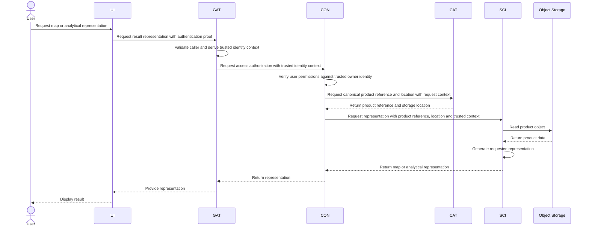
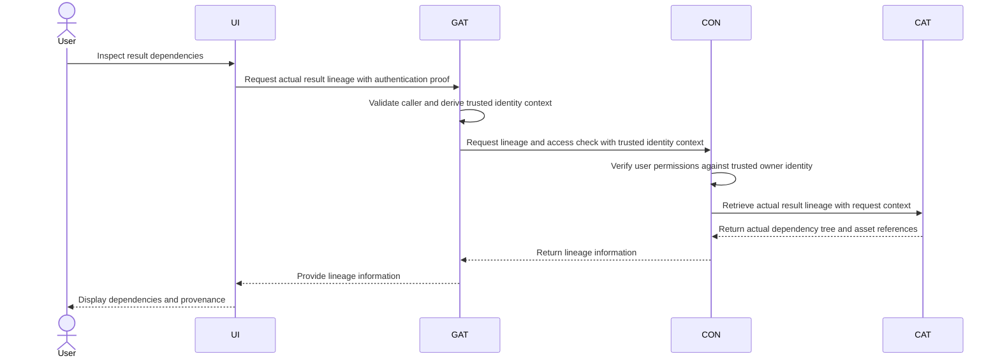
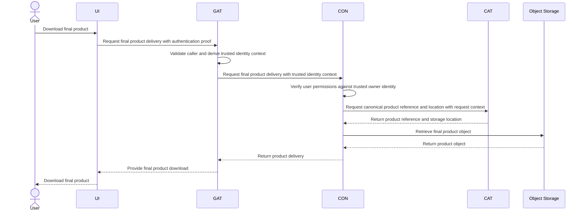
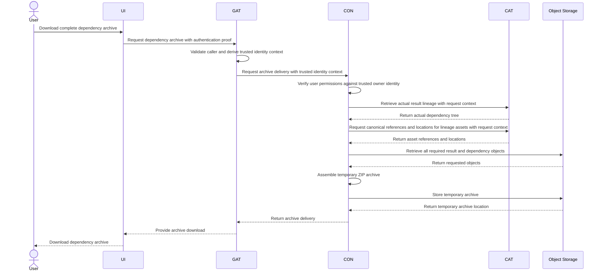

# Retrieve and Display a Result

**Status:** Validated sequence diagrams — design baseline  
**Companion documents:** [Component Interaction Design](../system-interactions/component-interaction-design.md) · [Component Interaction Matrix](../system-interactions/component-interaction-matrix.md) · [Submit Analysis Request](./submit-analysis-request.md) · [Execute Analysis](./execute-analysis.md)  
**Last updated:** 12 November 2026

## Purpose

Describe the result-retrieval paths after a product has been generated and registered in CAT:

1. Generate and display a map or analytical representation.
2. Inspect the actual lineage of a result.
3. Download the final product alone.
4. Download an on-demand archive containing the result and its actual dependencies.

These are separate user-facing operations. They share authorization and asset-discovery responsibilities but have different delivery behavior.

## 1. Visualize a result

The request is routed through CON for authorization. CON then asks CAT for the canonical product reference and current storage location, and passes the information to SCI. CON does not keep a duplicate mapping. SCI reads the stored product directly and generates the requested representation.

## 2. Inspect actual result lineage

The displayed lineage is the actual provenance recorded by CAT for the selected result. It is not the planned execution graph held by CON.

Physical storage locations are not part of the user-facing lineage representation unless a separate authorized use case explicitly requires them.

## 3. Download the final product only

This operation delivers only the requested product. It does not package dependencies.

The exact transfer mechanism (for example streaming through the API or secure temporary access) is not fixed by this logical sequence and belongs to interface/contract design. The physical storage location must not be exposed directly to UI.

## 4. Download the complete dependency archive

The archive is generated on demand from CAT's actual lineage and the corresponding canonical asset references and current locations. CON owns the delivery orchestration and ZIP assembly, but does not maintain a duplicate asset catalogue or storage mapping.

## Validated responsibility rules

1. **CON does not maintain a duplicate product/asset catalogue.** CAT remains the single source of truth for canonical asset references, storage locations and actual lineage.
2. When CON needs a result, it queries CAT for the canonical product reference and its current storage location. This applies to visualization, final-product download and dependency-archive generation.
3. For visualization, CON performs the access check using the trusted owner identity, obtains the canonical reference and location from CAT, then passes them and the required trusted context to SCI. SCI reads the object directly from storage and generates the requested representation.
4. For lineage inspection, CON asks CAT for the actual lineage and returns the relevant provenance information through GAT. The planned execution graph is not substituted for actual lineage.
5. For final-product download, CON retrieves the reference and location from CAT and orchestrates delivery of that product alone.
6. For a dependency archive, CON requests actual lineage and the references/locations for all required assets, retrieves the objects from storage and assembles the ZIP on demand.
7. GAT is the only public REST entry point. UI does not access CAT or object storage directly.
8. Physical storage locations are internal information and are not exposed as part of the public UI contract.
9. Authenticated retrieval calls carry caller proof to GAT. GAT derives trusted identity context; CON uses the owner identity for authorization and propagates the context to CAT/SCI for audit and correlation. Credentials are not copied into logs or indiscriminately forwarded.

## Notes and boundaries

- The archive is temporary and must be subject to an expiration and cleanup policy. Exact TTL, storage and access-security details remain open.
- The sequence does not prescribe a worker topology, NATS subjects, REST routes, HTTP status codes, streaming protocol or secure-link mechanism.
- CAT may reorganize stored objects. CON must ask CAT for the current canonical location when it needs to access an asset; it must not rely on a copied storage mapping.
- The four diagrams describe separate operations. The exact user-facing endpoints and shared implementation mechanisms are deferred to interface and contract design.
