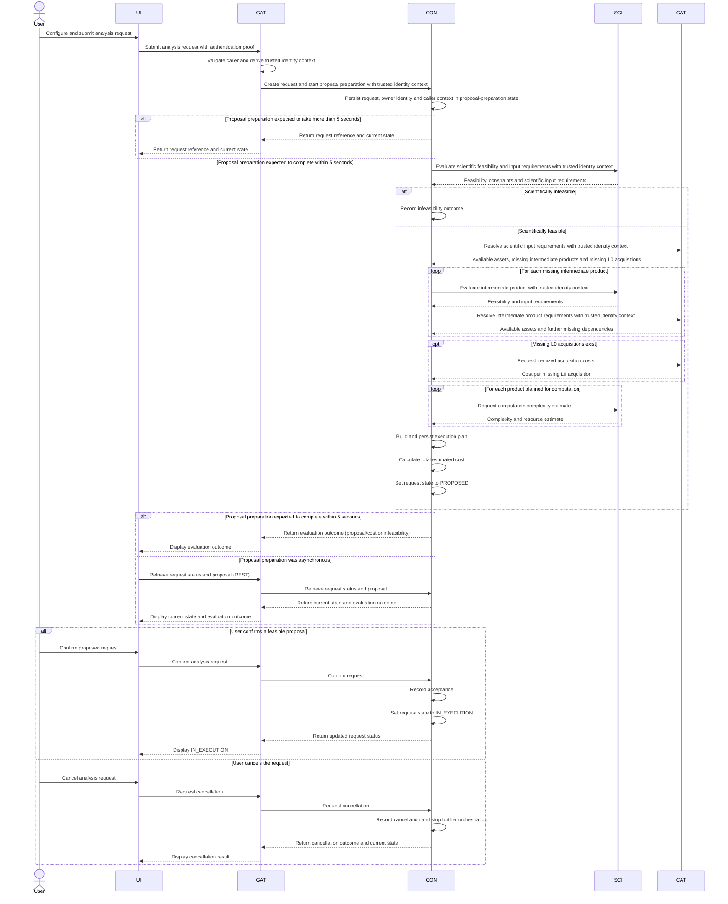

# Submit Analysis Request

**Status:** Validated sequence diagram — design baseline  
**Companion documents:** [Component Interaction Design](../system-interactions/component-interaction-design.md) · [Component Interaction Matrix](../system-interactions/component-interaction-matrix.md)  
**Last updated:** 12 November 2026

## Purpose

Describe the lifecycle from submission of an analysis request through feasibility/dependency evaluation and cost estimation, up to explicit confirmation or cancellation.

The evaluation and cost estimation are part of the submitted request. They are not separate pre-submission operations.

## Sequence

## Interpretation

- For a proposal-preparation operation expected to take more than 5 seconds, GAT returns the request reference and current state without waiting for completion. UI retrieves the state and eventual proposal through REST. Notifications are optional refresh mechanisms.
- For a proposal-preparation operation expected to complete within 5 seconds, the current API interaction remains open until the evaluation result is available.
- The cancellation branch is drawn after proposal preparation for readability. The same cancellation interaction is available in every request state except `COMPLETED`, including while proposal preparation or execution is ongoing.
- This diagram does not detail interruption or reconciliation of an acquisition or computation that is already running when cancellation is requested. That behavior belongs in the execution and failure/recovery sequences.

## Validated decisions represented

- Submitting an analysis request starts the complete proposal-preparation path; feasibility and cost estimation are not separate pre-submission operations.
- GAT validates caller authentication and derives the trusted identity context. CON persists the authenticated owner/caller context with the request before carrying out evaluation and dependency resolution. The exact name of the proposal-preparation state remains open.
- SCI returns scientific feasibility and scientific input requirements. CAT resolves those criteria to concrete assets and reports missing dependencies.
- CON recursively resolves requirements for missing intermediate products.
- CAT provides itemized costs for missing L0 acquisitions. SCI provides computation-complexity estimates; CON calculates the user-facing total estimate.
- The plan and estimate are stored with the request. Once proposal preparation is complete and the request is feasible, the request enters `PROPOSED`.
- Confirmation is a separate explicit user action; CON then transitions the request to `IN_EXECUTION`.
- The user can request cancellation from any request state except `COMPLETED`. GAT transmits the request to CON; CON owns its lifecycle and stops further orchestration.
- REST remains the source of truth for request state. Notifications may refresh the UI but are not required for correct operation.
- Any operation expected to take more than 5 seconds is exposed asynchronously at the user-facing API. The execution mode is selected before starting the operation; the API does not switch an in-flight synchronous operation to asynchronous after a timeout.
- The trusted context preserves the authenticated subject/owner, initiating actor where distinct, calling client/origin and request/trace correlation. The raw external credential is not indiscriminately forwarded and is never logged.

## Notes and boundaries

- The exact state vocabulary for proposal preparation and infeasibility is not fixed here. Confirmation is available only when a feasible proposal has been returned; cancellation remains available in every request state except `COMPLETED`.
- The 5-second rule concerns the user-facing API behavior. It does not select a worker technology, messaging transport or internal synchronous/asynchronous protocol.
- The sequence intentionally does not prescribe REST endpoints, HTTP status codes, NATS subjects, worker topology or payload schemas.
- The precise behavior when cancellation races with an already-running acquisition or computation must be completed in the execution and failure/recovery sequences, then specified in interface contracts.
