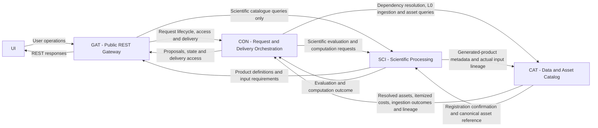

# Component Interaction Design

**Status:** Working design note — component responsibilities, architecture decisions and open design questions  
**Last updated:** 12 November 2026

> This document records the responsibility model, architecture decisions and open design questions for M0. The detailed, user-validated interaction inventory is maintained separately in [M0 Component Interaction Matrix](./component-interaction-matrix.md). This note is not an implementation specification, an API contract, or an ADR. The component specifications under [documentation/specifications/components](../../specifications/components/) are earlier drafts and have not yet been reconciled with every decision below.

## 1. Modelling boundary

The logical component interaction diagram contains exactly five peer components:

- **UI** — user interaction and presentation.
- **GAT** — the unique public REST Gateway.
- **CON** — request, execution-plan and delivery orchestration.
- **SCI** — scientific product semantics, input requirements and computation.
- **CAT** — concrete data/product discovery, dependency resolution, acquisition and asset lineage.

The following are **not** peer logical components:

- **Workers** are execution mechanisms used to run long-running operations.
- **NATS** is internal messaging infrastructure.
- **EO data providers** are external systems.
- **Object storage** is infrastructure behind asset access. An S3-compatible store has been considered, but no storage backend is selected by this note.

A logical component does not imply a dedicated package, process, container, service or deployment.

## 2. Current responsibility model

| Logical component | Owns | Explicitly does not own |
|---|---|---|
| **UI** | Product discovery experience, request configuration/confirmation, Requests view, maps, plots, layer visibility/overlay and download actions. | Scientific computation, dependency resolution, internal messaging, physical storage access. |
| **GAT** | The public REST boundary; request validation at the API boundary; routing UI operations to the responsible internal components; exposing request state, product representations and download access. | Authoritative request lifecycle, final cost policy, scientific algorithms, physical asset inventory or storage layout. |
| **CON** | Feasibility/cost coordination, request lifecycle, persisted execution plan, orchestration of missing product generation, and delivery orchestration. | Scientific product semantics, scientific compatibility decisions, provider-specific data acquisition, physical asset cataloguing or scientific computation. |
| **SCI** | Scientific product definitions/methods, scientific feasibility, the input requirements/criteria needed for a computation, computation and scientific result characterization. | Knowing which concrete product instances or acquisitions are currently available; resolving those requirements to actual assets; provider inventory/pricing; request lifecycle and user access policy. |
| **CAT** | Discovery and availability of concrete source observations and product assets; resolution of scientific input requirements to exact available product/acquisition instances; identification of missing inputs; L0 acquisition/ingestion and provider-specific acquisition pricing; asset registration and actual product lineage. | Defining scientific methods, deciding scientific compatibility, or orchestrating the generation of missing scientific products. |

### Terminology clarification: what SCI knows

The statement that “SCI does not know the products” means that SCI does **not** know the concrete product instances, acquisitions or assets available in CAT, nor which exact existing instances can satisfy a request.

SCI still owns scientific product definitions and methods. For a requested computation, it describes the required inputs using scientific criteria such as spectral band, spectral/spatial resolution, acquisition period, spatial scope and quality constraints. It does not select the concrete acquisition or product instance.

### Dependency ownership

Three distinct views must not be conflated:

1. **Scientific input requirements — SCI.** What kinds of inputs a scientific method needs.
2. **Concrete dependency resolution — CAT.** Which exact existing product/acquisition instances satisfy those requirements, and which are missing.
3. **Planned execution — CON.** Which missing intermediate products must be generated, which L0 inputs must be acquired, and in which dependency order the request will be executed.

CAT also preserves the **actual lineage** of each generated product: the exact parent product/acquisition instances and versions that were really used. Planned dependencies and actual lineage are different records.

The internal L0–LN levels are conceptual. The lineage model should preserve exact direct input references and must not assume that every product dependency is necessarily one level lower if a product definition legitimately skips a level.

## 3. Validated interaction inventory

The detailed interaction inventory is maintained in the companion [M0 Component Interaction Matrix](./component-interaction-matrix.md). That document records the producer/consumer direction, purpose and validated route of each interaction.

The key interface boundaries are:

- **UI ↔ GAT:** all user-facing operations use the single public REST Gateway.
- **GAT ↔ CON:** request lifecycle, feasibility/cost coordination, result-access authorization and Delivery Management.
- **CON ↔ SCI:** scientific evaluation (including input requirements), computation-complexity estimation and product computation/outcome.
- **CON ↔ CAT:** concrete dependency resolution, itemized L0 acquisition costs, ingestion, asset references and actual lineage.
- **SCI ↔ CAT:** generated-product metadata/lineage registration and registration confirmation only.
- **GAT ↔ SCI:** scientific product catalogue and theoretical input requirements only. Requests to visualize or analyze a specific computed result pass through CON for access authorization.
- **GAT ↔ CAT:** no direct interface in the validated model.

The matrix is the reference for the interaction list. This note explains the responsibilities and the reasoning behind those boundaries.

## 4. Feasibility, dependency resolution and cost estimation

The current proposal flow is:

1. The user configures a requested product, spatial scope, period and parameters in UI.
2. GAT forwards the feasibility/cost evaluation to CON.
3. CON asks SCI for scientific feasibility and the scientific input requirements for the requested product.
4. CON passes those criteria to CAT.
5. CAT resolves the criteria against its concrete inventory and returns:
   - exact existing product/acquisition instances that can be reused;
   - missing intermediate products that do not currently exist;
   - missing L0 acquisition requirements;
   - acquisition/download costs for missing L0 data.
6. For each missing intermediate product, **CON** asks SCI for that product's own scientific input requirements and asks CAT to resolve those requirements. CON repeats this process until the required existing products and L0 inputs are identified.
7. CON builds and persists the planned execution for the request, including the intermediate products that must be generated.
8. CON calculates the total estimated request cost.

The estimated cost must include at least:
- acquisition/download costs for missing L0 data, supplied by CAT;
- generation/computation costs for every missing intermediate and requested product.

CON owns the overall request estimate and admission decision. SCI may provide feasibility and computation-complexity information. The precise computation-pricing model, rates and cost breakdown are not yet defined.

**Important boundary:** CAT may identify that an L1 product is missing and resolve the L0 inputs needed by that L1 product once CON asks SCI for its requirements. CAT does not trigger or orchestrate the L1 computation. CON owns recursive planning and all missing scientific-product generation.

## 5. Request acceptance and execution

The current request lifecycle decision is:

- Before user confirmation, the request is in **PROPOSED** state and has an estimated cost and a planned set of required acquisitions/product generations.
- When the user accepts the proposal, CON records the accepted execution plan and transitions the request from **PROPOSED** to **IN_EXECUTION**.
- CON asks CAT to acquire/ingest the missing L0 source data.
- Once the required source assets are available, CON dispatches the missing product computations to SCI in dependency order.
- SCI computes each product and registers the generated asset with CAT, reporting the actual inputs used.
- CAT records the exact actual lineage for each generated product.
- SCI reports the computation outcome to CON. On success, the outcome includes the canonical CAT reference of the registered product. CON owns the authoritative request state and updates it when the required execution is complete or has failed.
- Computation progress is handled through technical observability (for example traces or a workflow visualizer); it is not a required business notification from SCI to CON.

The persisted request plan must identify the products that CON intends to generate. It is not a substitute for CAT's actual asset lineage.

The exact task-state model, proposal-preparation and infeasibility states, cancellation outcome semantics, partial-failure behavior, retries and replanning rules remain open.

## 6. Delivery orchestration and dependency archive

CON owns **delivery orchestration**.

For a request to download a product together with its dependencies:

1. GAT forwards the delivery request to CON.
2. CON checks the caller's access rights.
3. CON asks CAT for the actual dependency lineage of the requested result and the references/access information for the assets in that lineage.
4. CON coordinates archive generation from those actual assets.
5. GAT exposes the resulting download access to UI.

The archive is generated **on demand**, rather than pre-generated for every product, to avoid unnecessary storage consumption. It is temporary and must expire/ be cleaned up according to a retention policy.

CON owns the delivery lifecycle. The mechanism that physically assembles the ZIP (for example, a worker executing a CON-orchestrated task), temporary archive registration/location, secure asset access references and the exact TTL/cleanup policy remain open. Physical storage paths must not leak into the public UI contract.

Archive contents must be based on the **actual lineage** of the result, not merely the planned execution graph.

## 7. Visualization and multiple layers

SCI provides product representations for map visualization and analytical plots/time series. For a specific computed result, the route is GAT → CON → SCI: CON verifies access rights before requesting the representation, then the result returns through CON and GAT to UI. The direct GAT ↔ SCI interface is limited to the scientific product catalogue and its theoretical input requirements.

The user should be able to display and overlay multiple product layers. Visual overlay is not equivalent to scientific harmonization or proof that products are directly comparable. Native resolution, spatial support, temporal support and any representation transformations remain explicit.

## 8. Execution and messaging mechanisms

- Workers may execute long-running L0 ingestion, scientific computation and archive-generation tasks. They are mechanisms, not logical components.
- NATS is a candidate internal messaging transport, not a logical component and never a UI-facing interface.\n- User-facing API policy: an operation expected to take more than **5 seconds** is exposed asynchronously from the start. GAT returns a request reference and current state; UI retrieves progress/outcome through REST. Notifications are optional refresh mechanisms, while REST remains the source of truth. This policy does not determine whether the internal work uses a worker, NATS or another mechanism.
- CON is expected to dispatch scientific computation to SCI through an asynchronous interaction.
- SCI reports one business outcome to CON: success or failure, including the canonical CAT product reference after successful registration. Completion transport (for example a durable NATS event) remains undecided. A key concern is avoiding lost completion notifications if CON is unavailable; durability, acknowledgement, correlation, idempotency and recovery must be examined in the contract/execution design.
- Computation progress is not a required SCI → CON business notification. Use technical observability (traces or a workflow visualizer) to inspect execution progress.
- The precise CAT ingestion dispatch and outcome-notification mechanism also remains to be specified.

## 9. Decisions still open

1. **Request state and cancellation:** exact proposal-preparation/infeasibility states, cancellation outcome semantics, and how CON reconciles cancellation with already-running ingestion or computation.\n2. **Computation pricing:** how SCI's complexity information is converted into a computation cost, how CON aggregates it with CAT's L0 acquisition costs, and how actual cost is recorded.
3. **Messaging and reliability:** whether CON → SCI dispatch and SCI → CON completion use NATS or another mechanism; how durable delivery, retries, acknowledgement, correlation and idempotency are handled.
4. **CAT ingestion workflow:** how CON requests missing L0 ingestion, how partial/failed acquisition is reported, and how CON resumes the planned execution.
5. **Execution-plan representation:** whether CON stores a DAG, an ordered task plan or another representation; how shared dependencies are deduplicated and costed.
6. **Actual lineage semantics:** the exact metadata/version references CAT records for each generated product, including direct inputs actually consumed.
7. **Delivery implementation:** which execution mechanism assembles the ZIP, how CAT provides asset access, where the temporary archive is held, and its TTL/cleanup behavior.
8. **Storage backend:** S3-compatible object storage has been considered, but is not selected by this note.
9. **Visualization representations:** supported map/plot representations, bounded spatial/temporal retrieval and overlay limitations. The access route is established: GAT → CON for authorization, then CON → SCI for representation retrieval.
10. **Product and asset catalogue interfaces:** the criteria model, catalogue queries, product metadata and stable asset-reference/access contract.

## 10. Reconciliation with existing component drafts

The existing first-draft component specifications contain assumptions that predate this refinement. In particular, the current SCI draft assigns scientific dependency-graph resolution and ingestion/calculation orchestration to the SCI Gateway. The current CON draft says CON does not resolve dependency plans, and the current CAT draft does not yet describe the full provider-pricing and concrete dependency-resolution responsibility captured here.

For this design, the decisions in this working note are the latest user-reviewed direction. The individual component specifications should be reconciled only after the component interaction model and matrix are reviewed. Do not silently treat the older draft statements as settled decisions or update the future contract schemas from this note alone.

## 11. Component Interaction Diagram

The diagram below shows the validated logical interaction boundaries and the main purpose of each direction. It contains exactly the five MEOGAP logical components. It does not prescribe REST routes, message topics, protocols, deployment units or execution mechanisms.

### Important interpretation rules

- **GAT ↔ SCI** is limited to the scientific product catalogue and theoretical input requirements. Visualization and analytical representations of a specific result follow **GAT → CON → SCI**, with the response returning through CON and GAT.
- **GAT ↔ CAT does not exist** in the validated model. User-facing asset and lineage operations are routed through CON.
- **CON ↔ SCI** covers scientific evaluation, computation-complexity estimation, computation dispatch and computation outcome. Progress monitoring is handled by observability, not by a required business notification.
- **CON ↔ CAT** covers concrete dependency resolution, itemized L0 acquisition pricing, ingestion coordination, canonical asset references and actual lineage.
- **SCI ↔ CAT** is limited to registering generated-product metadata and actual inputs, then returning registration confirmation and the canonical asset reference. CAT does not supply input references directly to SCI; the path is **CAT → CON → SCI**.
- SCI writes generated outputs directly to object storage. CON reads objects directly from storage for delivery. Object storage is infrastructure, not a logical component in this diagram.

Workers, NATS, EO data providers and object storage are deliberately excluded from the component diagram. They may be shown as supporting mechanisms or external infrastructure in the relevant sequence diagrams, without being represented as peer logical components.
