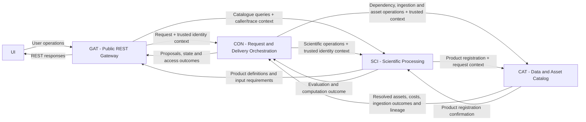

# Component Interaction Design

**Status:** Working design note — component responsibilities, architecture decisions and open design questions  
**Last updated:** 16 November 2026

> This document records the responsibility model, architecture decisions and open design questions for M0. The detailed, user-validated interaction inventory is maintained separately in [M0 Component Interaction Matrix](./component-interaction-matrix.md). This note is not an implementation specification, an API contract, or an ADR. The component specifications under [documentation/specifications/components](../../specifications/components/) are earlier drafts and have not yet been reconciled with every decision below.

## 1. Modelling boundary

The logical component interaction diagram contains exactly five peer components:

- **UI** — user interaction and presentation.
- **GAT** — the unique public REST Gateway.
- **CON** — request, execution-plan and delivery orchestration.
- **SCI** — scientific product semantics, input requirements and computation.
- **CAT** — concrete data/product discovery, dependency resolution, acquisition and asset lineage.

The following are **not** peer logical components:

- **Workers** are execution mechanisms used to run long-running operations.
- **NATS** is internal messaging infrastructure.
- **EO data providers** are external systems.
- **Object storage** is infrastructure behind asset access. An S3-compatible store has been considered, but no storage backend is selected by this note.

A logical component does not imply a dedicated package, process, container, service or deployment.

## 2. Current responsibility model

| Logical component | Owns | Explicitly does not own |
|---|---|---|
| **UI** | Product discovery experience, request configuration/confirmation, Requests view, maps, plots, layer visibility/overlay and download actions. | Scientific computation, dependency resolution, internal messaging, physical storage access. |
| **GAT** | The public REST boundary; request validation; validation of caller authentication; derivation and propagation of trusted caller identity context; routing UI operations to the responsible internal components; exposing request state, product representations and download access. | Authoritative request lifecycle, final cost policy, access-policy decisions, scientific algorithms, physical asset inventory or storage layout. |
| **CON** | Feasibility/cost coordination, request lifecycle and ownership association, persistence of the trusted caller context with the request and execution plan, access decisions, orchestration of missing product generation, and delivery orchestration. | Authentication credential validation, scientific product semantics, scientific compatibility decisions, provider-specific data acquisition, physical asset cataloguing or scientific computation. |
| **SCI** | Scientific product definitions/methods, scientific feasibility, the input requirements/criteria needed for a computation, L0 source harmonization methods and generation of MEOGAP-compatible product/quality representations, derived-product computation and scientific result characterization; consuming trusted caller/request context for correlation, tracing and audit where needed. | Knowing which concrete product instances or acquisitions are currently available; resolving those requirements to actual assets; provider inventory/pricing; request lifecycle, caller authentication and user access-policy decisions. |
| **CAT** | Discovery and availability of concrete source observations and product assets; resolution of scientific input requirements to exact available product/acquisition instances; identification of missing inputs; L0 provider acquisition, preservation of original source representations and provider-specific acquisition pricing; registration of Source Assets and their original/harmonized representation references; registration of Derived Assets and actual product lineage; consuming trusted caller/request context for correlation, tracing and audit where needed. | Defining scientific methods, deciding scientific compatibility, caller authentication, user access-policy decisions, or orchestrating the generation of missing scientific products. |

### Terminology clarification: what SCI knows

The statement that “SCI does not know the products” means that SCI does **not** know the concrete product instances, acquisitions or assets available in CAT, nor which exact existing instances can satisfy a request.

SCI still owns scientific product definitions and methods. For a requested computation, it describes the required inputs using scientific criteria such as spectral band, spectral/spatial resolution, acquisition period, spatial scope and quality constraints. It does not select the concrete acquisition or product instance.

### Dependency ownership

Three distinct views must not be conflated:

1. **Scientific input requirements — SCI.** What kinds of inputs a scientific method needs.
2. **Concrete dependency resolution — CAT.** Which exact existing product/acquisition instances satisfy those requirements, and which are missing.
3. **Planned execution — CON.** Which missing intermediate products must be generated, which L0 inputs must be acquired, and in which dependency order the request will be executed.

CAT also preserves the **actual lineage** of each generated product: the exact parent product/acquisition instances and versions that were really used. Planned dependencies and actual lineage are different records.

The internal L0–LN levels are conceptual. The lineage model should preserve exact direct input references and must not assume that every product dependency is necessarily one level lower if a product definition legitimately skips a level.

## 3. Validated interaction inventory

The detailed interaction inventory is maintained in the companion [M0 Component Interaction Matrix](./component-interaction-matrix.md). That document records the producer/consumer direction, purpose and validated route of each interaction.

The key interface boundaries are:

- **UI ↔ GAT:** all user-facing operations use the single public REST Gateway.
- **GAT ↔ CON:** request lifecycle, feasibility/cost coordination, result-access authorization and Delivery Management.
- **CON ↔ SCI:** scientific evaluation (including input requirements), computation-complexity estimation, L0 source harmonization requests/outcomes and derived-product computation/outcomes.
- **CON ↔ CAT:** concrete dependency resolution, itemized L0 acquisition costs, original L0 acquisition/preservation/registration, representation references and availability, and actual lineage.
- **SCI ↔ CAT:** registration of derived-product metadata/actual lineage and registration of SCI-generated harmonized representations against an existing Source Asset, with confirmation. CAT does not perform harmonization.
- **GAT ↔ SCI:** scientific product catalogue and theoretical input requirements only. Requests to visualize or analyze a specific computed result pass through CON for access authorization.
- **GAT ↔ CAT:** no direct interface in the validated model.

The matrix is the reference for the interaction list. This note explains the responsibilities and the reasoning behind those boundaries.

### Identity and caller-context propagation (ENG-15)

Identity propagation is a cross-cutting property of the interactions below, not a separate business component or an independent request lifecycle.

1. An authenticated public REST call must carry proof of caller authentication. GAT validates that proof using the configured trust mechanism and derives a **trusted identity context**. Explicitly unauthenticated bootstrap and health/readiness operations are exceptions.
2. Caller-supplied owner IDs or identity headers are not proof of identity. The authoritative owner is derived from the validated caller identity, not accepted from request payload fields.
3. GAT passes the trusted context to CON for request, access and delivery operations. Direct GAT → SCI catalogue calls also carry the caller/trace context needed for audit and correlation; they do not grant access to private computed results.
4. CON associates the authenticated subject/owner, initiating actor where distinct, calling client/origin and request/trace correlation with the request. It propagates the trusted context to the SCI and CAT operations it coordinates, including L0 ingestion, dependency resolution, computation dispatch, result registration context and delivery.
5. Deferred execution must persist enough trusted context with the request/task so that a worker can restore the original owner and correlation when it runs. It must not depend on the original HTTP request remaining alive or on forwarding the external credential itself.
6. CON remains responsible for request/result/delivery authorization decisions. SCI and CAT consume only the context needed for their operations, audit and tracing; they do not independently redefine ownership or make user access-policy decisions.
7. Propagate the validated identity context, not the raw external credential by default. Credentials and secrets must never be written to logs or traces.

The credential format, authentication provider, identity claims and internal context representation remain open for interface/security contract design (see [ENG-15](../../specifications/eng.md#eng-15)).

## 4. Request submission, feasibility, dependency resolution and cost estimation

The proposal-preparation flow starts when the user submits an analysis request. There is no separate pre-submission feasibility or cost-estimation operation.

1. The user configures a product, spatial scope, period and parameters in UI and submits the request.
2. GAT forwards the submitted request to CON.
3. CON creates and persists the request in a proposal-preparation state before starting evaluation. The exact state name is not fixed yet.
4. CON asks SCI for scientific feasibility and the scientific input requirements for the requested product.
5. CON passes those criteria to CAT.
6. CAT resolves the criteria against its concrete inventory and returns:
   - exact existing product/acquisition instances that can be reused;
   - missing intermediate products that do not currently exist;
   - missing L0 acquisition requirements;
   - acquisition/download costs for missing L0 data.
7. For each missing intermediate product, **CON** asks SCI for that product's own scientific input requirements and asks CAT to resolve those requirements. CON repeats this process until the required existing products and L0 inputs are identified.
8. CON builds and persists the planned execution for the request, including the intermediate products that must be generated.
9. CON calculates the total estimated request cost.
10. If the request is feasible and proposal preparation is complete, CON moves it to **PROPOSED** and returns the proposal and estimated cost through GAT.

The estimated cost must include at least:
- acquisition/download costs for missing L0 data, supplied by CAT itemized per acquisition;
- generation/computation costs for every missing intermediate and requested product.

CON owns the overall request estimate and admission decision. SCI may provide feasibility and computation-complexity information. The precise computation-pricing model, rates and cost breakdown are not yet defined.

**Important boundary:** CAT may identify that an L1 product is missing and resolve the L0 inputs needed by that L1 product once CON asks SCI for its requirements. CAT does not trigger or orchestrate the L1 computation. CON owns recursive planning and all missing scientific-product generation.

## 5. Request acceptance, cancellation and execution

The current request lifecycle decisions are:

- On submission, CON first persists the request in a proposal-preparation state. Feasibility evaluation, dependency resolution and cost estimation are then performed as part of that request. The exact proposal-preparation state name is not fixed yet.
- Once proposal preparation is complete and the request is feasible, it enters **PROPOSED** state with an estimated cost and a planned set of required acquisitions/product generations.
- When the user accepts the proposal, CON records the acceptance and transitions the request from **PROPOSED** to **IN_EXECUTION**.
- The user may request cancellation in any request state except **COMPLETED**. GAT forwards the cancellation request to CON. CON owns the request lifecycle, records the cancellation and stops further orchestration. How already-running ingestion or computation is interrupted or reconciled is addressed in the execution and failure/recovery flows.
- CON asks CAT to acquire the missing L0 source data. CAT preserves and registers the original provider representation; this does not by itself make the Source Asset ready for computations that require MEOGAP-harmonized inputs.
- CON then requests SCI to harmonize the registered Source Asset. SCI generates MEOGAP-compatible product and quality representations and supplies their references/provenance to CAT for registration against the existing Source Asset. CAT reports representation registration/availability; it does not execute harmonization.
- CON evaluates the persisted dependency plan and dispatches only computations whose required input representations are available. Independent eligible tasks may be dispatched concurrently; workers execute the tasks but do not resolve dependencies or repeatedly requeue blocked tasks.
- SCI computes each product and writes its result object to storage. SCI sends CAT the computation metadata, initial object location and exact input references actually consumed. CAT registers the product and actual lineage, then confirms registration to SCI.
- SCI reports the computation and registration outcome to CON, distinguishing scientific execution failure from asset-registration failure. CON owns the authoritative request/task state. CON does not store CAT's canonical asset reference or storage location; when it needs an asset, it queries CAT using the logical product/task identifier from its execution plan.

> **M0 implementation note.** CON and SCI are not integrated in M0. The Gateway mock implements a simplified asynchronous lifecycle `queued → processing → succeeded` (with `failed` and `cancelled`) and creates the deterministic result itself. There is no manual proposal confirmation in M0. The proposal/preparation flow above remains the target architecture; see [ADR-0005](../../architecture/adr/ADR-0005-m0-asynchronous-request-lifecycle.md).
- After a successful registration, CON records the task outcome and reevaluates the plan. Newly unblocked tasks become eligible for dispatch.
- If a required task fails, CON marks that task **FAILED** and keeps its dependent tasks **BLOCKED**. Independent tasks that were already **READY** or **RUNNING** when the failure was detected are allowed to finish. CON waits for that work to settle; if a requested output remains impossible to produce, CON marks the overall request **FAILED**.
- The request enters **COMPLETED** only after all requested outputs are available and registered in CAT. CON verifies completion using the logical output identifiers in its execution plan and CAT's authoritative catalogue state; it does not maintain a duplicate asset-reference/location mapping.
- Computation progress is handled through technical observability (for example traces or a workflow visualizer); it is not a required business notification from SCI to CON.

The persisted request plan identifies the logical products/tasks that CON intends to generate. It is not a substitute for CAT's actual asset lineage and does not duplicate CAT's canonical asset references or storage locations.

The exact task-state vocabulary, proposal-preparation and infeasibility states, cancellation outcome semantics, retry policy, idempotency and replanning behavior remain open.

## 6. Delivery orchestration and dependency archive

CON owns **delivery orchestration**. Both delivery operations are asynchronous from the start:

- **GC-08:** request delivery of the final product alone.
- **GC-09:** request on-demand assembly of an archive containing the result and assets in its actual lineage.

Each operation returns a persistent delivery identifier and its initial state. CON performs authorization, resolves canonical references and locations through CAT, retrieves the relevant objects from object storage, and orchestrates delivery preparation. When the delivery is ready or has failed, its state and, when ready, secure access information are exposed through **UI-21** using the same delivery resource identified by GC-08/GC-09.

**GC-10 through GC-13 are removed as separate logical interactions.** Status and access are properties of the delivery resource, not independent interface families. The exact REST resource shape remains implementation-level work.

The archive is generated **on demand**, rather than pre-generated for every product, to avoid unnecessary storage consumption. It is temporary and must expire/be cleaned up according to a retention policy.

CAT remains the sole authority for canonical asset references, current storage locations and actual lineage. CON queries CAT when required and uses the returned information for the current delivery operation; it does not maintain a duplicate product/asset catalogue or persistent storage mapping. The mechanism that physically retrieves objects and assembles the ZIP (for example, a worker executing a CON-orchestrated task), temporary archive registration/location, secure access references and the exact TTL/cleanup policy remain open. Physical storage paths must not leak into the public UI contract.

Archive contents must be based on the **actual lineage** of the result, not merely the planned execution graph.

## 7. Visualization and multiple layers

SCI provides product representations for map visualization and analytical plots/time series. For a specific computed result, the route is GAT → CON → SCI: CON verifies access rights before requesting the representation, then the result returns through CON and GAT to UI. The direct GAT ↔ SCI interface is limited to the scientific product catalogue and its theoretical input requirements.

The user should be able to display and overlay multiple product layers. Visual overlay is not equivalent to scientific harmonization or proof that products are directly comparable. Native resolution, spatial support, temporal support and any representation transformations remain explicit.

## 8. Execution and messaging mechanisms

### 8.1 Fixed interaction modes

| Interface family | Mode | Included interactions |
|---|---|---|
| UI ↔ GAT | Mixed, fixed per interaction | **Async:** UI-05, UI-13, UI-14, UI-21. **Sync:** UI-01, UI-02, UI-06, UI-07, UI-08, UI-09, UI-10, UI-11, UI-12, UI-15, UI-16, UI-18, UI-19, UI-20, UI-22, UI-23, UI-24. |
| GAT ↔ CON | Mixed, fixed per interaction | **Async:** GC-02/GC-02-R, GC-08, GC-09. **Sync:** GC-03, GC-04/GC-04-R, GC-05/GC-05-R, GC-06/GC-06-R, GC-07/GC-07-R, GC-14/GC-14-R. |
| GAT ↔ SCI | Sync | GS-01/GS-02. |
| CON ↔ SCI | Async | CS-01/CS-02, CS-03/CS-04, CS-05/CS-06, CS-07/CS-08. |
| CON ↔ CAT | Mixed, fixed per interaction | **Async:** CC-01/CC-02 (CC-03/CC-04 are included in the dependency-resolution outcome), CC-05/CC-06, CC-07/CC-08. **Sync:** CC-09/CC-10, CC-11/CC-12, CC-13, CC-14. |
| SCI ↔ CAT | Sync | SC-01/SC-02, SC-03/SC-04. |

No conditional mode is used. **Async** means the initiating operation starts persistent work and its business outcome arrives later, correlated with the original operation. The classification does not prescribe an internal worker, RPC, NATS or other transport. **Sync** means the logical interaction completes as a request/response exchange.

### 8.2 User-facing asynchronous behavior and long-running operations

Proposal preparation is asynchronous end-to-end from submission. UI-05 starts the request; GC-02 creates/persists it and returns a request identifier/current preparation state. CON then performs CS-01/02, CS-03/04 and CC-01/06 as asynchronous interactions. The eventual proposal or infeasibility result is exposed through the request resource and UI-17. There is no execution path that waits to see whether proposal preparation happens to finish within five seconds.

Final-product delivery (UI-13/GC-08) and dependency-archive delivery (UI-14/GC-09) are also asynchronous from the start. GC-08/GC-09 return a delivery identifier and initial state. UI-21 exposes the subsequent delivery state and secure access through that same delivery resource. GC-10 through GC-13 are not separate logical interactions.

The five-second ENG-03 threshold remains a general rule for other user-facing operations not explicitly fixed by these decisions. Notifications are optional refresh mechanisms; REST remains the source of truth. This policy does not select a worker technology, messaging transport or internal protocol.

### 8.3 Internal asynchronous outcomes and reliability

- Workers may execute long-running L0 ingestion, scientific computation and archive-generation tasks. They are mechanisms, not logical components.
- NATS is a candidate internal messaging transport, not a logical component and never a UI-facing interface.
- CON submits asynchronous scientific operations to SCI: feasibility (CS-01/02), complexity estimate (CS-03/04), harmonization (CS-07/08) and computation (CS-05/06). SCI reports the corresponding outcome with request/operation correlation.
- CON submits asynchronous dependency-resolution, itemized acquisition-cost and L0-ingestion operations to CAT (CC-01/02, CC-05/06, CC-07/08). CAT reports their outcomes with correlation.
- SCI ↔ CAT registration (SC-01/02 and SC-03/04) remains synchronous in the logical model. The actual implementation may use an internal mechanism that preserves the same request/confirmation semantics.
- SCI's computation outcome distinguishes scientific execution failure from CAT asset-registration failure. It does not carry a canonical asset-to-location mapping. CON queries CAT when it needs a canonical reference or current location. Completion transport remains undecided; durability, acknowledgement, correlation, idempotency and recovery must be examined in contract/execution design.
- Computation progress is not a required SCI → CON business notification. Use technical observability (traces or a workflow visualizer) to inspect execution progress.
- The precise internal dispatch, outcome and retry guarantees for each asynchronous interaction remain to be specified.

## 9. Decisions still open

1. **Request state and cancellation:** exact proposal-preparation/infeasibility states, cancellation outcome semantics, and how CON reconciles cancellation with already-running ingestion or computation.
2. **Failure recovery:** which failure categories are retryable, retry limits/backoff, idempotency, whether partially successful independent outputs remain available after an overall request failure, and cleanup or reconciliation of objects written to storage but not registered in CAT.
3. **Computation pricing:** how SCI's complexity information is converted into a computation cost, how CON aggregates it with CAT's L0 acquisition costs, and how actual cost is recorded.
4. **Messaging and reliability:** whether CON → SCI dispatch and SCI → CON completion use NATS or another mechanism; how durable delivery, retries, acknowledgement, correlation and idempotency are handled.
5. **CAT ingestion workflow:** how CON requests missing L0 ingestion, how partial/failed acquisition is reported, and how CON resumes the planned execution.
6. **Execution-plan representation:** whether CON stores a DAG, an ordered task plan or another representation; how shared dependencies are deduplicated and costed.
7. **Actual lineage semantics:** the exact metadata/version references CAT records for each generated product, including direct inputs actually consumed.
8. **Delivery implementation:** which execution mechanism assembles the ZIP, how CAT provides asset access, where the temporary archive is held, and its TTL/cleanup behavior.
9. **Storage backend:** S3-compatible object storage has been considered, but is not selected by this note.
10. **Visualization representations:** supported map/plot representations, bounded spatial/temporal retrieval and overlay limitations. The access route is established: GAT → CON for authorization, then CON → SCI for representation retrieval.
11. **Product and asset catalogue interfaces:** the criteria model, catalogue queries, product metadata and stable asset-reference/access contract.
12. **Identity and security contracts:** the authentication/trust mechanism, credential format, identity claims, trusted internal context representation and its integrity protection/propagation. ENG-15 establishes the required behavior; concrete choices belong to M0-E02-T03 and any necessary security ADR.

## 10. Reconciliation with existing component drafts

The existing first-draft component specifications contain assumptions that predate this refinement. In particular, the current SCI draft assigns scientific dependency-graph resolution and ingestion/calculation orchestration to the SCI Gateway. The current CON draft says CON does not resolve dependency plans, and the current CAT draft does not yet describe the full provider-pricing and concrete dependency-resolution responsibility captured here.

For this design, the decisions in this working note are the latest user-reviewed direction. The individual component specifications should be reconciled only after the component interaction model and matrix are reviewed. Do not silently treat the older draft statements as settled decisions or update the future contract schemas from this note alone.

## 11. Component Interaction Diagram

The diagram below shows the validated logical interaction boundaries and the main purpose of each direction. It contains exactly the five MEOGAP logical components. It does not prescribe REST routes, message topics, protocols, deployment units or execution mechanisms.

### Important interpretation rules

- **GAT ↔ SCI** is limited to the scientific product catalogue and theoretical input requirements. Visualization and analytical representations of a specific result follow **GAT → CON → SCI**, with the response returning through CON and GAT.
- **GAT ↔ CAT does not exist** in the validated model. User-facing asset and lineage operations are routed through CON.
- **CON ↔ SCI** covers scientific evaluation, computation-complexity estimation, computation dispatch and computation outcome. Progress monitoring is handled by observability, not by a required business notification.
- **CON ↔ CAT** covers concrete dependency resolution, itemized L0 acquisition pricing, ingestion coordination, canonical asset references and actual lineage.
- **SCI ↔ CAT** is limited to registering generated-product metadata and actual inputs, then returning registration confirmation. CAT does not supply input references directly to SCI; the path is **CAT → CON → SCI**.
- CON stores logical product/task identifiers and execution outcomes, not a duplicate mapping of products to canonical asset references or storage locations. When CON needs to use a product, it queries CAT for the current canonical reference and location.
- SCI writes generated outputs directly to object storage. CON reads objects directly from storage for delivery. Object storage is infrastructure, not a logical component in this diagram.

Workers, NATS, EO data providers and object storage are deliberately excluded from the component diagram. They may be shown as supporting mechanisms or external infrastructure in the relevant sequence diagrams, without being represented as peer logical components.

## 12. Failure and recovery sequence

The validated failure policy and its two distinct scenarios are documented in [Failure and Recovery](../sequence_diagrams/failure-and-recovery.md). It distinguishes scientific computation failure from CAT asset-registration failure, preserves already eligible independent work, and prevents false request completion.

## 12. User-owned AOI library — approved refinement (23 November 2026)

The user-owned AOI library is a deliberate exception to the earlier rule that prohibited direct GAT ↔ CAT interaction.

- CAT owns persistent AOI records and geometries. Each AOI is scoped to the authenticated user; CAT derives ownership from trusted caller context propagated by GAT. A caller-supplied owner/user identifier is not accepted as an authorization input.
- GAT exposes the AOI library through the public REST API and calls CAT directly for AOI library operations. This direct interface is limited to user-owned AOI CRUD and does not authorize GAT to bypass CON for requests, private result representations, lineage, or delivery.
- CON remains authoritative for request lifecycle, proposal/cost coordination, user-facing authorization of result access, and orchestration. A submitted request carries a snapshot of the selected AOI geometry and its source AOI identifier/revision; later edits or deletion of the library AOI do not mutate an existing request.
- The UI can create an AOI independently from a request, browse/reuse saved AOIs, and start a request using an existing AOI. The request wizard may branch into AOI creation and return to the pending request with the newly saved AOI selected.
- This exception supersedes earlier “no direct GAT ↔ CAT interface” statements only for AOI library operations. All other validated routes remain unchanged.

The public and internal REST operations are specified in the gateway and catalog OpenAPI documents under projects/meogap_interfaces/rest/. The M0 Gateway implementation may use a deterministic in-memory/mock CAT provider, but the public contract must remain stable when CAT becomes persistent.

## 13. Map workspace interaction model — approved UX direction (23 November 2026)

The map occupies the full application viewport. Navigation, toolbars, drawers and inspectors are overlays above the map; opening or closing them must not resize the map container. The UI follows a map-first GIS workbench model inspired by the supplied Carbon Mapper reference.

- A compact top toolbar exposes global actions including Requests, Indicators and Account.
- A vertical left toolbar opens contextual tools/panels for product discovery, AOI drawing and the AOI library, with POI/LOI tools only where supported by M0 scope.
- Requests opens an overlay panel that lists the authenticated user's requests and offers request creation. Request creation is also reachable from product details and the spatial-input workflow.
- Indicators remains a visible, clickable empty view in M0; it has no functional backend operations in this milestone.
- One primary overlay panel is open at a time. A lower, collapsible inspector may display selected-result metadata, legends, quality/provenance and time-series content when those capabilities exist.
- AOI drawing is a spatial-editing action, not request submission. Saving creates or updates a library AOI. Creating a request is separate and selects an existing AOI or creates one before returning to the request form.
- Pointer events inside overlays must not leak to the map. Drawing tools explicitly own map pointer interactions while active. Basemap context is visually distinct from scientific result layers.

These are UI interaction requirements, not a mandate for a specific component library or map SDK.

